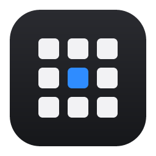
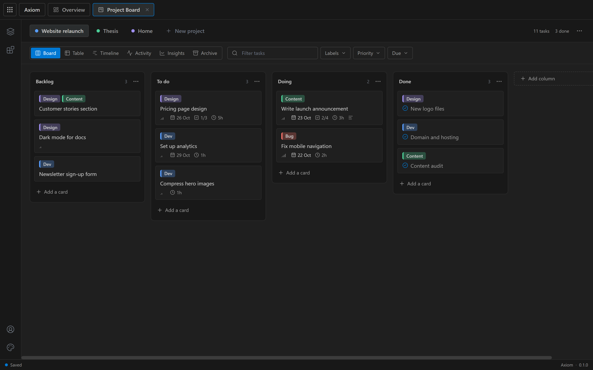
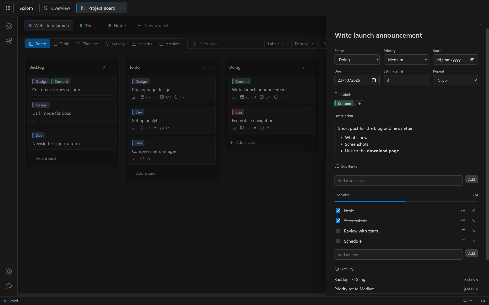
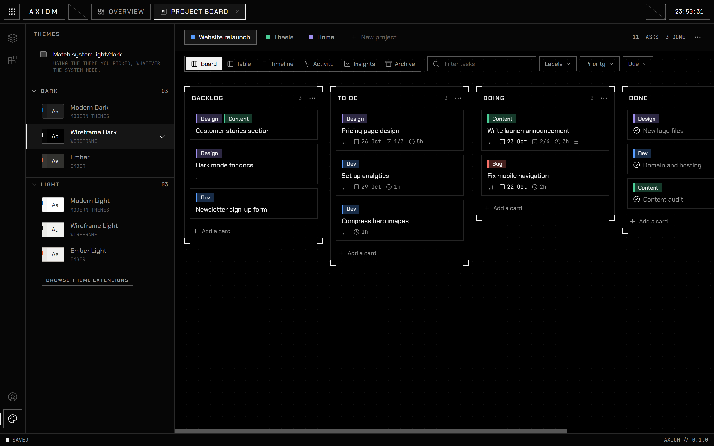
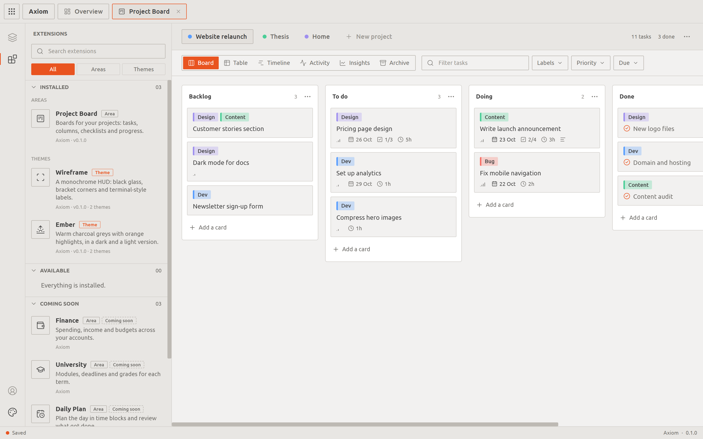

# Axiom

**Track every area of your life in one place.**

A fast, private desktop app built from extensions: project boards today, with finance, university and daily planning on the way.

## Why Axiom

- **Instant.** Everything is saved on your computer first, so every click is immediate and it all works offline.
- **Private by default.** No account needed. Your data stays on your machine unless you choose to sync it.
- **Sync when you want it.** Sign in to keep your computers in step. Edits made on two machines at once are merged field by field, so neither is lost.
- **Built from extensions.** Each area of your life is an extension you install, and the look of the whole app is a theme you can swap or make yourself.

## Project Board

Plan and track projects on boards that combine the best of Trello and GitHub Projects.

- Drag-and-drop boards with your own columns and card limits
- Cards with descriptions (Markdown), labels, priorities, dates, estimates and checklists
- Sub-tasks, repeating tasks and reusable card templates
- Board, table and timeline views, with filters
- Activity history and progress charts for each project
- Archive finished cards without losing their history

## Themes

Change how everything looks, from colours and fonts to corner shapes and labels. Axiom follows your system's light and dark mode, and ships with three theme packs: **Modern** (the default), **Wireframe** and **Ember**.

| Wireframe | Ember Light |
| --- | --- |
|  |  |

## Coming soon

- **Daily Plan:** plan the day in time blocks and review what got done.
- **University:** modules, deadlines and grades for each term.
- **Finance:** spending, income and budgets across your accounts.

## Getting Axiom

Installers are on the way. Until then, you can build Axiom from source: see **[docs/DEVELOPMENT.md](docs/DEVELOPMENT.md)**. It takes a few minutes with Rust and Node.js installed.

## Your data

- Everything is saved in a database on your computer. Export all of it as JSON at any time from the Account sidebar.
- An account is optional. If you sign in, passwords are hashed with Argon2id, your sign-in is kept in your system's credential store, and you can see and sign out every device from the app.
- Deleting your account removes it and everything synced to it from the server.

Found a security issue? Please report it privately: see [SECURITY.md](SECURITY.md).

## Contributing

Bug reports, ideas and pull requests are welcome. **[docs/DEVELOPMENT.md](docs/DEVELOPMENT.md)** explains how to run Axiom locally, how the code is organised, how sync works, and how to make your own theme. Every pull request is built and tested automatically.

## License

[MIT](LICENSE)
