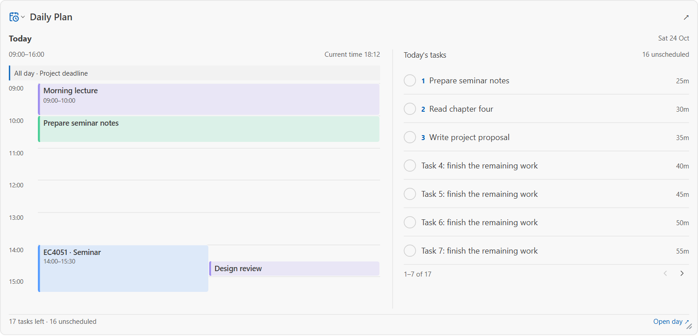
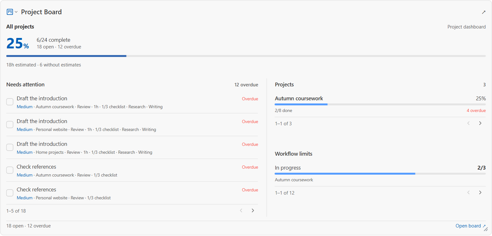
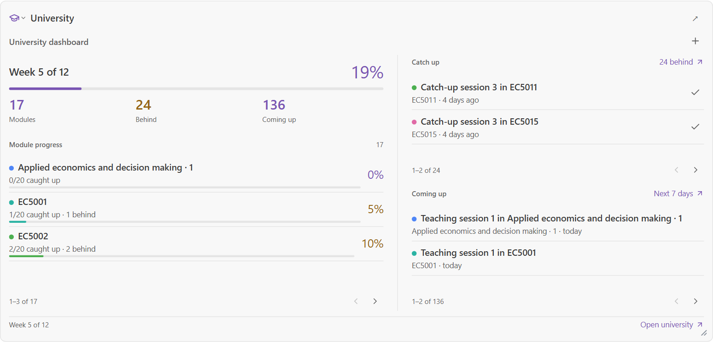
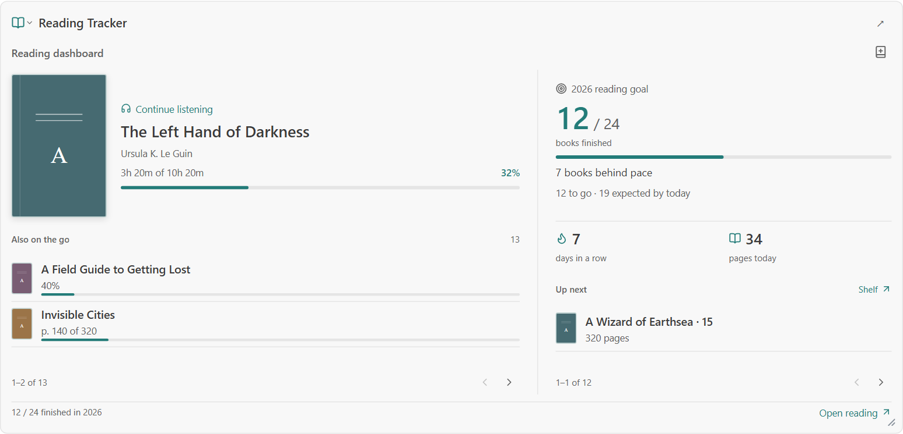
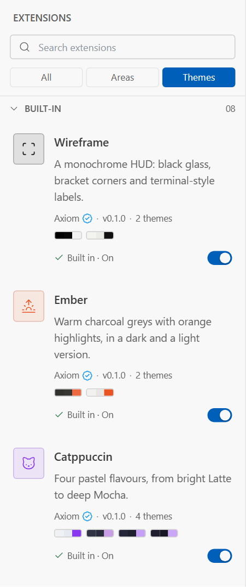

<div align="center">


**A desktop home for your plans, projects, reading, studies and everyday life.**

Local storage. Optional sync. Nine built-in areas. A workspace you can make your own.

[](https://github.com/IvHonor/axiom/actions/workflows/ci.yml)
[](LICENSE)
[](https://github.com/IvHonor/axiom/releases/latest)

**[Download for Windows](https://github.com/IvHonor/axiom/releases/latest)** · **[Build from source](#run-locally)** · **[Report an issue](https://github.com/IvHonor/axiom/issues)**

</div>

---

Axiom brings the things you usually keep in separate apps into one desktop workspace. Plan a day around your calendar, move a project forward, catch up on lectures, keep a reading habit, or write down a thought before it disappears.

Start with the areas you need. Arrange their summaries on your overview, hide the ones you don't want to see, and open the full tools in tabs when you need more detail. Your work is saved to a local SQLite database; an account is optional for using the local tools.

**This README describes the current source tree.** Packaged releases may lag behind ongoing development. Windows is the current release target; macOS and Linux installers are not published by the release workflow.

[Explore the areas](#nine-areas-one-workspace) · [Customize your workspace](#an-overview-that-fits-you) · [Themes](#make-it-feel-like-yours) · [Data and privacy](#your-data-and-privacy) · [Development](#run-locally) · [Contributing](#extensions-and-contributing)

## An overview that fits you



*Current UI components, rendered with sample data. The screenshots below use the same approach; no personal account data is shown.*

- **Move and resize your tiles.** Drag a section into place while neighboring tiles move aside. A landing outline shows the destination; Escape cancels the move.
- **Choose the right amount of detail.** Daily Plan, Project Board, Reading and University offer multiple overview layouts that adapt to the space available, from compact summaries to larger dashboards.
- **Keep only what matters in view.** Hide an area from the overview without deleting its data, then bring it back from the left navigation. Extensions can also be switched off.
- **Keep thoughts close.** Add individual sticky notes to the overview, then move, resize and edit them there.
- **Move between tools naturally.** Preview areas in tabs, keep the ones you're using open, and collapse the sidebar when you want more room. Motion respects the system's reduced-motion preference.

## Nine areas, one workspace

All nine areas below are implemented and bundled with the app.

| Area | What you can do |
| --- | --- |
| **Daily Plan** | Build a day from time blocks, choose three priorities, estimate tasks, check capacity and carry unfinished work forward. Use routines, a week view and focus insights. Connect Google Calendar, Outlook or iCloud/CalDAV. |
| **Project Board** | Organize work with custom columns, card limits, checklists, subtasks, labels, priorities, dates and estimates. Switch between board, table and timeline views. Use recurring tasks, templates, activity history and shared boards with admin, editor or viewer roles. |
| **Reading Tracker** | Find books through Open Library, organize shelves and log print, ebook or audiobook progress. Keep notes, quotes and bookmarks, rate books, set a yearly goal and follow your reading streak. |
| **University** | Set up terms and modules, generate lectures from a repeating timetable, and track attendance, catch-up and review separately. See overdue lectures, upcoming sessions and topics that need another look. |
| **Learning** | Track the skills you're teaching yourself and the textbooks, courses and YouTube playlists you learn them from. Chapters come from the book file's own contents (EPUB or PDF), a pasted contents list or course curriculum, or the playlist. Tick them off, time your study, and mark chapters for spaced review. |
| **Finance** | Track accounts, income, spending, budgets and recurring bills. Import CSV, OFX, QFX or QIF statements, categorize transactions, work across currencies and review trends and net worth. |
| **Notes** | Write rich text with Markdown shortcuts. Organize notes in nested folders, add tags, pin favorites and connect ideas with `[[links]]` and backlinks. Create coloured sticky notes and export your writing as Markdown. |
| **Journal** | Keep a daily entry with prompts, mood, energy and tags. See writing streaks, a calendar of entries, insights and memories from the same date in previous years. Daily Plan intentions and reflections sit alongside your writing. |
| **Goals** | Track numeric targets, milestones and one-off goals. Compare progress with a deadline, record check-ins and make if-then plans. Goals can follow activity in Finance, Reading, Journal, Project Board, University and Learning. |
| **Birthdays** | Remember birthdays and anniversaries, see who's coming up, keep gift ideas and set reminders. Organize people into groups and import contacts. |

<table>
  <tr>
    <td width="50%"><strong>Projects at a glance</strong><br><br></td>
    <td width="50%"><strong>Stay on top of your term</strong><br><br></td>
  </tr>
</table>

### Build a reading habit



Your overview can be a quick check-in or a place to spend a little longer. Reading combines the current book, progress, yearly target and next reads; resize the tile and its layout changes with it.

## Make it feel like yours



Axiom includes **eight theme packs with twenty variants**:

| Pack | Character |
| --- | --- |
| **Modern** | Soft neutrals and familiar system typography |
| **Wireframe** | Monochrome surfaces and bracketed details |
| **Ember** | Warm charcoal with orange highlights |
| **Catppuccin** | Four pastel palettes, from Latte to Mocha |
| **Tokyo Night** | Midnight blues and violet accents |
| **Rosé Pine** | Muted rose, pine and cream |
| **Gruvbox** | Earthy colours and warm contrast |
| **Nord** | Arctic slate and frost-blue accents |

Themes cover colours, fonts, corner shapes and other interface details. Choose a fixed appearance or follow your system's light/dark setting. Coloured extension icons and palette previews help you recognize each area and theme.

The default Modern theme stays available. Other built-in extensions and theme packs can be switched on or off from **Extensions**.

<br clear="all">

## Get Axiom

1. Open the **[latest release](https://github.com/IvHonor/axiom/releases/latest)**.
2. Download the Windows installer ending in **`_x64-setup.exe`**.
3. Install and open Axiom. Choose your areas and start locally; sign in when you want account sync.

Installed builds check for updates and offer them in the app. Update packages are signed for Axiom's updater. The Windows installer is not currently Authenticode-signed, so Windows may show a publisher warning; use the release linked above and check the download's source before proceeding.

Account registration can require email confirmation and administrator approval, depending on the server's configuration. A pending account does not prevent you from using the local tools.

### Useful shortcuts

| Shortcut | Action |
| --- | --- |
| `Ctrl+B` | Toggle the sidebar |
| `Ctrl+Shift+X` | Open Extensions |
| `Ctrl+K`, then `Ctrl+T` | Open Themes |
| `Ctrl+W` | Close the current tab |
| Arrow keys on a tile's move or resize handle | Move or resize that tile |
| `Escape` during a tile drag | Restore its previous position |

## Your data and privacy

**Local storage comes first.** Axiom saves feature data to a SQLite database on your computer. Core editing works offline. Sync, calendar connections, book lookups and other online integrations need a network connection when used.

**Sync is optional.** Sign in to synchronize supported data between devices. Ordinary records merge changes field by field; Notes and Journal use collaborative document updates for writing. Project boards can also be shared with other accounts. Same-field edits can still conflict—sync is not a replacement for a backup.

**Sensitive areas have end-to-end encrypted sync.** Finance, Notes, Journal, Birthdays and Goals are encrypted on the device before their feature records are sent to the sync server. Keep the recovery code: it may be needed after a password reset. Other synced areas and account metadata are not covered by this feature-data encryption. Optional email reminders may send the reminder information needed for delivery.

**A PIN protects access to the app.** The optional PIN lock can activate at launch and after inactivity. It does not encrypt the local database or exported files.

**You can take your data with you.** Export local data as JSON from the Account sidebar; Notes and Journal also support Markdown export. Account controls include device management and account deletion. Treat exports as private files and keep your own backups.

For a security concern, follow **[SECURITY.md](SECURITY.md)** and report it privately rather than opening a public issue.

## Run locally

Axiom uses **Tauri 2 + Rust**, **React + TypeScript + Vite**, and **SQLite via SeaORM**. Its optional account/sync server uses **Axum + PostgreSQL**. Notes and Journal use **Tiptap + Yjs** for rich text and collaborative document updates.

Install Node.js LTS, stable Rust and the [Tauri prerequisites for your operating system](https://v2.tauri.app/start/prerequisites/). On Windows, that includes the C++ build tools and WebView2 runtime.

```sh
git clone https://github.com/IvHonor/axiom.git
cd axiom
npm ci
npm run tauri dev
```

`npm run tauri dev` launches the desktop app and its frontend development server. `npm run dev` starts only Vite; the normal application needs Tauri's native commands to access local data.

### Optional services

| Capability | Configuration |
| --- | --- |
| **Accounts and sync** | Copy [`server/.env.example`](server/.env.example) to `server/.env`. Set a PostgreSQL `DATABASE_URL` and a strong `JWT_SECRET`, then run `npm run server` in another terminal. Development builds default to `http://localhost:8787`. |
| **A different account server** | Copy [`src-tauri/.env.example`](src-tauri/.env.example) to `src-tauri/.env` and set `AXIOM_SERVER_URL` before building the app. |
| **Google Calendar** | Set `AXIOM_GOOGLE_CLIENT_ID` and `AXIOM_GOOGLE_CLIENT_SECRET` for a registered desktop OAuth client. |
| **Outlook / Microsoft 365** | Set `AXIOM_MICROSOFT_CLIENT_ID` for a registered Microsoft application. |
| **iCloud / CalDAV** | Connect through the app; iCloud uses an app-specific password. No Google or Microsoft client ID is needed. |
| **Email and account approval** | See `RESEND_API_KEY`, `EMAIL_FROM`, `ADMIN_EMAILS` and `WAITLIST` in the server's example configuration. Development email codes are logged when an email provider is not configured. |

The `src-tauri` settings are read **at build time**; restart the desktop development build after changing them. Both `.env` files are gitignored. Keep credentials out of commits, screenshots and issue reports.

Provider registration, self-hosting and release instructions live in **[the development guide](docs/DEVELOPMENT.md)**. The repository includes a [server Dockerfile](server/Dockerfile) and [Render configuration](render.yaml).

### Common commands

| Command | Purpose |
| --- | --- |
| `npm run tauri dev` | Develop with the native desktop backend |
| `npm run build` | Type-check and build the frontend |
| `npm run tauri build` | Build the desktop application and platform bundles |
| `npm run server` | Run the optional account/sync server |
| `cargo test --workspace --locked` | Run Rust workspace tests |
| `npm audit --audit-level=high` | Check JavaScript dependency advisories |
| `cargo audit` | Check Rust dependency advisories |

The [CI workflow](.github/workflows/ci.yml) builds the frontend, runs Rust tests and audits dependencies. Browser checks for responsive overview layouts, dragging, themes and visibility are documented in **[tests/README.md](tests/README.md)**. They use isolated sample data rather than your desktop database.

<details>
<summary><strong>Repository map</strong></summary>

| Path | Responsibility |
| --- | --- |
| [`src/shell/`](src/shell/) | Navigation, tabs, overview, account controls and shared UI |
| [`src/features/`](src/features/) | The nine areas and their frontend components |
| [`src/extensions/`](src/extensions/) | Extension manifests and the bundled registry |
| [`src/themes/`](src/themes/) | Theme packs and design settings |
| [`src-tauri/src/features/`](src-tauri/src/features/) | Feature data, commands, migrations and backend logic |
| [`src-tauri/src/sync/`](src-tauri/src/sync/) | Local change tracking, sync and board sharing |
| [`src-tauri/src/vault/`](src-tauri/src/vault/) | Encryption keys and encrypted sync support |
| [`server/`](server/) | Accounts, sync, sharing, email and server administration |
| [`crates/protocol/`](crates/protocol/) | Types shared by the app and server |
| [`tests/`](tests/) | Browser fixtures and interaction/layout checks |
| [`scripts/`](scripts/) | Branding, native icon generation and README screenshot capture |

</details>

## Extensions and contributing

**Extensions currently ship with Axiom's source.** The extension system organizes areas and themes; it is not yet a downloadable third-party plugin runtime or a public marketplace. Adding an area with new tables requires coordinated frontend, backend, migration and sync changes.

To contribute:

- **Report a bug:** include your app version, operating system, theme, steps to reproduce and a screenshot if it helps. Remove personal data and credentials first.
- **Suggest an improvement:** describe the task you're trying to complete and where the current interface gets in the way.
- **Add a theme:** start from [`src/themes/modern_themes/`](src/themes/modern_themes/), follow the [`Theme` type](src/extensions/types.ts), and register it in [`src/extensions/index.ts`](src/extensions/index.ts).
- **Build an area:** follow the feature folders on both sides of the Tauri boundary. Include migrations and sync registration where needed, and check overview layouts at small and large sizes.
- **Send a pull request:** explain the resulting behavior and how you checked it. Keep changes focused and preserve existing user data.

Start with **[the development guide](docs/DEVELOPMENT.md)** and **[the test guide](tests/README.md)**. Questions and feature requests are welcome in **[GitHub Issues](https://github.com/IvHonor/axiom/issues)**. The app also has a support button for contacting the project.

<details>
<summary><strong>Refreshing the README images</strong></summary>

Start `npm run dev -- --port 1427`, then run:

```sh
node scripts/capture-readme.mjs
```

This requires Playwright and its Chromium browser. If Playwright is installed outside the project, set `PLAYWRIGHT_MODULE` to the file URL of its `index.mjs`. `README_PREVIEW_ORIGIN` overrides the default local server address.

The script captures real components from the isolated browser fixtures in `tests/` and saves the images under `docs/screenshots/`. The banner is a repository-owned SVG in `docs/images/`.

</details>

## License

Axiom is open source under the **[MIT License](LICENSE)**.
